<!-- Theme-aware profile hero -->
<picture>
  <source media="(prefers-color-scheme: dark)" srcset="./dark.svg">
  <source media="(prefers-color-scheme: light)" srcset="./light.svg">
  
</picture>

<h1 align="center">Hi, I'm Aryan Singh Rana 👋</h1>

  <strong>Full Stack Developer</strong> · Learning and building

  Noida, India · 2nd Year, Hi-Tech Institute of Engineering and Technology

---

### About

I'm a student and developer learning to build across the frontend and backend. I enjoy turning ideas into practical projects and strengthening my fundamentals by building.

### Featured Projects

- **SHG Savings & Micro-Loan Tracker** — savings and micro-loan management project.
- **PDF Q&A RAG Chatbot** — document-based question-answering project using retrieval-augmented generation.
- **Weather App** — weather application.
- **Makelane** — web project.

### Engineering Stack

**Languages:** C++, JavaScript, Python

**Frontend:** React.js

**Backend:** Node.js, Express.js

**Database:** MongoDB, Mongoose

**Tools:** Git, GitHub

### Current Focus

- Strengthening full-stack development fundamentals
- Building practical frontend and backend projects
- Learning by experimenting, debugging, and shipping

### Connect

- GitHub: [@Aryan2969](https://github.com/Aryan2969)

---

  Learning continuously · Building consistently

